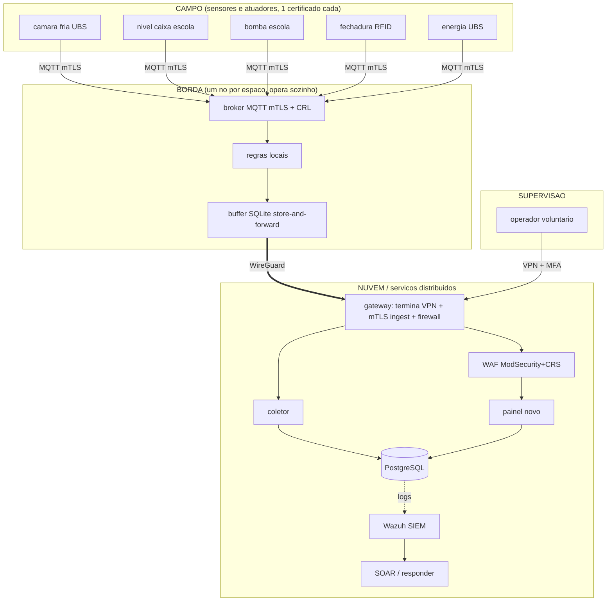

# Relatório Técnico — Rede Comunitária Vila Aurora

Global Solution 2026.2 · Cybersecurity · Desafio Resilient Community Infrastructure

Entregáveis E1 (Arquitetura), E3 (Testes de Segurança) e E4 (Laudo Forense) consolidados,
cada um em sua seção, conforme a observação do enunciado.

> Rascunho para a equipe completar com os números do seu ambiente e os prints do vídeo.
> Os trechos entre colchetes `[ ]` são para preencher. Todos os dados são sintéticos.

---

# E1 — Documento de Arquitetura

## 1. Visão geral

A solução é uma infraestrutura em quatro camadas (campo, borda, nuvem e supervisão) que
mantém a operação local de cada espaço comunitário quando a conectividade falha, e que
detecta, responde e permite investigar incidentes.

As setas de dado sobem do campo para a nuvem. O operador só chega no painel por dentro da
VPN e com MFA. O SIEM lê os logs de todos e alimenta a resposta automática.

## 2. Camadas

| Camada | Função | Componentes no protótipo |
|---|---|---|
| Campo | coletar e atuar | containers Python publicando MQTT (`campo/sensor.py`) |
| Borda | operar sozinho em cada espaço | Mosquitto (TLS + require_certificate), regras locais, buffer (`borda/`) |
| Nuvem | consolidar, IA, SIEM, orquestração | gateway, coletor, PostgreSQL, Wazuh, SOAR (`nuvem/`, `siem/`, `soc/`) |
| Supervisão | visualizar, alertar, intervir | painel web acessível com MFA e RBAC (`nuvem/painel/`) |

## 3. Fluxos de dados

1. **Telemetria**: sensor publica no broker da borda (mTLS). A borda aplica regra local,
   pseudonimiza o que for dado pessoal, grava no buffer e envia em lote para o coletor via
   VPN. O coletor grava no banco com idempotência por `msg_id`.
2. **Comando/agenda**: criado no painel, a borda busca por pull, **valida** (espaço, perfil,
   horário, alto impacto) e só então repassa ao atuador.
3. **Alerta**: regra local da borda ou regra de detecção do SIEM gera alerta; o SOAR responde
   conforme o risco.

## 4. Modelo de ameaças (STRIDE, diferencial do RT)

| Ameaça (STRIDE) | Onde | Controle |
|---|---|---|
| Spoofing | dispositivo se passando por outro | mTLS com certificado único por dispositivo |
| Spoofing | e-mail falso da prefeitura | SPF/DKIM/DMARC + verificação fora de banda |
| Tampering | adulterar agenda da bomba | regra local de piso na borda ignora valor perigoso da nuvem |
| Tampering | alterar logs | logs centralizados, hash na coleta, cadeia de custódia |
| Repudiation | negar quem fez o quê | auditoria no painel + NTP |
| Information disclosure | dump de usuários via SQLi | consulta parametrizada, menor privilégio, pseudonimização |
| Denial of service | internet cai | borda autônoma + 4G de reserva na UBS |
| Elevation of privilege | operador virar admin | RBAC + MFA + aprovação de dois para alto impacto |

## 5. Decisões e trade-offs

- **WireGuard em vez de IPsec**: mais simples de configurar e auditar, cifras modernas. O
  trade-off é menos recursos corporativos, que não precisamos aqui.
- **Certificado EC P-256 em vez de RSA**: mais leve para um Raspberry Pi, mesma segurança.
- **Isolation Forest em vez de LLM**: evita o risco de prompt injection (RT-17) e dá métrica
  objetiva. Trade-off: não faz triagem de texto, só de telemetria.
- **Validação na borda além da nuvem**: duplica lógica, mas é o que garante que uma nuvem
  comprometida não repita o INC-VA-0712.

## 6. Redundância proporcional (RT-03)

- **UBS**: tem 4G de reserva, porque a câmara fria de vacinas é crítica. Se a fibra cai, a
  borda troca o endpoint do túnel para o 4G sozinha e volta para a fibra quando ela retorna.
- **Escola, centro, horta, abrigo**: sem link redundante, em **modo degradado documentado**.
  A borda opera local e segura os dados no buffer até a fibra voltar. Justificativa: orçamento
  limitado; a prioridade de 4G é da UBS. É melhor uma borda autônoma bem feita do que 4G em
  todo lugar sem motivo.
- O que **não** tem redundância: a nuvem é única (um servidor do lab). Justificativa: a
  operação crítica não depende dela; se a nuvem cai, cada espaço segue local.

---

# E3 — Relatório de Testes de Segurança

## 1. SQL Injection, antes e depois (RT-08)

### Antes (painel legado)

- Alvo: `http://localhost:8081/historico`, campo `busca`.
- A consulta concatena a entrada: `... WHERE nome_usuario ILIKE '%<busca>%'`.
- Exploração manual (dump da tabela de usuários):
  `busca=zzz' UNION SELECT NULL::timestamp, login||':'||senha, cpf, perfil FROM legado.usuarios--`
- Exploração automatizada: `sqlmap -u "http://127.0.0.1:8081/historico?busca=ana" --cookie="session=..." --dump -D legado -T usuarios`
- Resultado: sqlmap confirmou injeção **UNION query, 4 colunas**, e extraiu as 41 linhas
  (dados sintéticos). Também foi possível alterar a agenda da bomba por `UPDATE` injetado.
- Evidência: `[print do sqlmap, print do dump, estado da agenda após o UPDATE]`.

### Depois (painel novo)

Defesa em profundidade:
1. Consulta parametrizada (`... WHERE v.nome ILIKE %s`, parâmetro separado).
2. Validação no servidor (regex: só letras, números, espaço, hífen, até 40).
3. Usuário de banco `painel_app` com privilégio mínimo, sem acesso ao schema `legado`.
4. Erro genérico com código, sem vazar SQL. WAF (ModSecurity + OWASP CRS) na frente.

- Reteste: mesma carga `' OR 1=1--` e `UNION SELECT` na busca de `/acessos`. Resultado:
  entrada rejeitada pela validação; o WAF bloqueia as regras 942xxx. `[print do reteste]`.

## 2. mTLS, VPN e segmentação (RT-04 a RT-07)

- **mTLS**: `openssl verify -CAfile ... -crl_check -CRLfile ... cert.pem` retorna OK. Conexão
  sem certificado no broker: recusada (`peer did not return a certificate`). Certificado
  revogado: recusado após recarregar a CRL. `[prints]`.
- **Revogação** (RT-05): `pki/revogar.sh <dispositivo>` publica a CRL nova; o dispositivo para
  de conectar. `[print do antes/depois]`.
- **VPN** (RT-06): WireGuard ativo (`wg show`), cifras modernas, acesso administrativo só pela
  VPN, nenhuma porta administrativa exposta (só a UDP do WireGuard).
- **Segmentação** (RT-07): redes Docker separadas e `internal`; firewall do gateway libera só
  o mínimo entre segmentos; peer não fala com peer. `[print do iptables -S e docker network]`.

## 3. MFA e RBAC (RT-09)

- Login exige senha + TOTP. 5 senhas erradas bloqueiam a conta por 15 min. `[print]`.
- Perfis: operador, técnico, coordenação, auditor. Comando de alto impacto exige aprovação de
  **outra** pessoa da coordenação (quem pede não aprova). `[print do fluxo de aprovação]`.

## 4. SPF, DKIM e DMARC (RT-10)

- Domínio fictício `vilaaurora.lab`. `phishing/verificar_dns.py` confirma os três:
  SPF com `-all`, DKIM 2048 bits, DMARC `p=quarantine`. `[print da saída]`.

## 5. Campanha de phishing simulado (RT-11)

- Gophish contra contas fictícias, e-mail para MailHog. Métricas coletadas:

| Métrica | Valor |
|---|---|
| Enviados | 5 |
| Abertura | 4 (80%) |
| Clique | 4 (80%) |
| Submissão | 3 (60%) |
| Reporte | 0 |

- Plano de conscientização: ver `phishing/README.md`.

## 5b. Resiliência e métricas medidas (RT-22, RT-23)

Teste de caos: WAN derrubada por ~32 minutos. Resultados medidos (`metricas/metricas.json`):

- Operação autônoma sem internet: 1903 s (~31,7 min), acima do mínimo de 30 min do RT-23.
- Reconciliação: 9022 mensagens enviadas pela borda, 9021 gravadas no banco, 1 duplicada descartada, perda estimada 0.
- Disponibilidade do enlace na janela do teste: 71,7% (janela de estresse com queda proposital de 32 min; não é operação normal).
- MTTD (detecção): ~0,03 s em modo ao vivo. MTTR (resposta automatizada): média ~99 s.
- Consumo da borda: ~40 MB de RAM, <0,5% de CPU, ~1 MB de banda. Compatível com Raspberry Pi.

## 6. IA & ameaças por IA

- Detecção de anomalia (RT-16): câmara fria, modelo híbrido (Isolation Forest + regra) F1 0,855, precisão 0,88, revocação 0,83, falso positivo 0,8%. Nível da água: limitação assumida (IF perde a maioria, LOF pega mas com ~30% de falso positivo), conclusão de que a regra determinística da borda é mais confiável. Detalhe em `ia/resultados/metricas.json`.
- Ameaças por IA (RT-18): phishing gerado por IA e voz clonada; controles de processo
  (verificação fora de banda, palavra-código, decisão sobre atuador nunca por áudio).
- Sem LLM, então o RT-17 (prompt injection) não se aplica. Decisão justificada na seção
  "Uso de IA".

---

# E4 — Laudo Forense do INC-VA-0712 (reproduzido em laboratório)

## 1. Escopo

Investigação do incidente INC-VA-0712 reproduzido no ambiente próprio da equipe
(`incidente/reproduzir.sh`). Objetivo: reconstruir a linha do tempo, confirmar o que foi
acessado e recomendar controles. Nenhum sistema de terceiros foi tocado.

## 2. Aquisição de evidências e cadeia de custódia

- Coleta por `forense/coletar.sh`. Cada item teve **SHA-256 calculado no momento da coleta** e
  registrado em `evidencias/INC-VA-0712-LAB/cadeia_custodia.csv` (item, arquivo, hash, bytes,
  quem coletou, data/hora UTC, origem, método).
- Itens: logs centralizados, dump do banco, tabelas-chave em CSV, estado do Docker, sessões
  de VPN (`wg show`), firewall, e o buffer das bordas.
- Integridade conferível depois com `forense/verificar.sh`. `[colar hash do pacote]`.

## 3. Linha do tempo consolidada (UTC)

Gerada por `forense/linha_do_tempo.py`, com relógios sincronizados por NTP. Resumo (preencher
com o seu `linha_do_tempo.md`):

| Hora UTC | Evento | Técnica ATT&CK |
|---|---|---|
| `[ ]` | login no painel legado com credencial de phishing | T1078 Valid Accounts |
| `[ ]` | busca com UNION SELECT (dump de usuários) | T1190 Exploit Public-Facing App |
| `[ ]` | UPDATE na agenda da bomba via injeção | T0836 Modify Parameter (ICS) |
| `[ ]` | reservatório esvazia | T0826 Loss of Availability |

## 4. Mapeamento MITRE ATT&CK

- **Initial Access**: T1566 Phishing, T1078 Valid Accounts, T1133 External Remote Services.
- **Execution/Impact (ICS)**: T1190, T0836 Modify Parameter, T0855 Unauthorized Command.
- **Collection**: T1213 Data from Information Repositories.

## 5. Conclusões

- O acesso foi possível por VPN sem MFA + SQL Injection. O atacante puxou a tabela de
  usuários e manipulou a bomba.
- Na arquitetura nova, a mesma cadeia é barrada: MFA na VPN, injeção corrigida, e a regra
  local da borda impede a bomba de esvaziar a caixa mesmo com a nuvem comprometida.

## 6. Recomendações

Já implementadas no protótipo: MFA, mTLS, consulta parametrizada, menor privilégio no banco,
regra local de piso, logs centralizados com NTP e detecção das 4 regras. Pendente para
produção: hardware real com firmware assinado (OTA) e captura de memória de nó comprometido.

---

# Uso de IA (declaração obrigatória)

- **Isolation Forest / LOF** (`ia/anomalias.py`): IA defensiva do projeto, detecção de
  anomalia em telemetria, com métricas medidas sobre dados sintéticos rotulados.
- **Assistente de IA generativa**: usado como apoio para rascunhar documentação e código de
  andaime, revisado e testado pela equipe. A equipe responde pelo conteúdo. Não foi usado LLM
  como componente em execução no sistema, por isso não há superfície de prompt injection
  (RT-17) a proteger.
